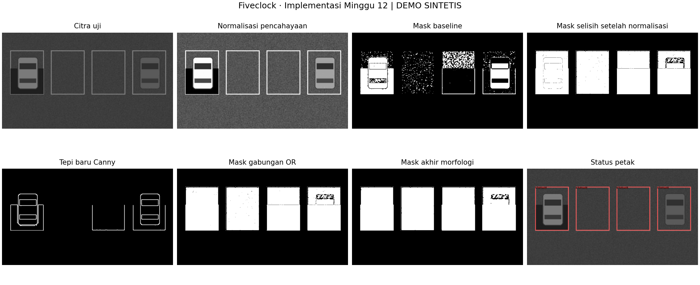

# Progres Minggu 12
16–20 November 2026

Fokus minggu ini adalah membuat alur program berjalan dari foto sampai keluar status petak. Saya catat hasil implementasinya lewat notebook dan contoh mask tiap tahap.

## Hasil pekerjaan

Program awal sudah bisa membaca foto dan XML, menetapkan poligon petak, serta memakai acuan kosong untuk setiap petak. Tahap yang sudah terhubung meliputi grayscale, normalisasi P5–P95, selisih intensitas, Canny, penggabungan OR, dan opening serta closing.

Keluaran program berupa mask setiap tahap, prediksi status petak, jumlah petak kosong, dan file PNG serta CSV.

Pengujian awal masih menggunakan gambar sintetis. Pada contoh yang dijalankan, metode lengkap salah membaca dua petak kosong sebagai terisi mobil. Area perubahan terlihat melebar setelah normalisasi. Temuan ini perlu diperiksa lagi saat data asli sudah dipakai.

## Bukti hasil minggu ini

Buka [notebook implementasi Minggu 12](Fiveclock_Implementasi_M12_Colab.ipynb). Bagian **Jalankan baseline dan metode klasik lengkap** sudah menyimpan keluaran teks berikut dari demo sintetis.

| Petak | Label acuan sintetis | Prediksi baseline | Prediksi metode lengkap |
|---|---|---|---|
| 1 | Terisi | Terisi mobil | Terisi mobil |
| 2 | Kosong | Kosong | Terisi mobil |
| 3 | Kosong | Terisi mobil | Terisi mobil |
| 4 | Terisi | Terisi mobil | Terisi mobil |

Baseline salah membaca satu petak kosong, sedangkan metode lengkap salah membaca dua petak kosong. Metode lengkap menghitung **0 petak kosong**, sementara label contoh memiliki **2 petak kosong**.

| Hasil | Bukti | Status |
|---|---|---|
| Alur implementasi awal | Kode pada notebook | Tersedia |
| Prediksi empat petak sintetis | Keluaran teks pada notebook dan tabel di atas | Tersedia |
| Visualisasi tahap pengolahan demo | [bukti_progres.png](hasil/bukti_progres.png) | Tersimpan di GitHub |
| Tabel prediksi empat petak demo | [status_petak.csv](hasil/status_petak.csv) | Tersimpan di GitHub |
| Evaluasi PKLot asli | [Hasil Minggu 13](../minggu13/README.md#bukti-hasil-minggu-ini) | Tersedia pada tahap berikutnya |

### Gambar hasil implementasi

PNG dan CSV di atas diekspor ulang pada 25 November 2026 dari notebook Minggu 12 dengan seed 42. Status dan rasio prediksinya cocok dengan keluaran teks yang sudah tersimpan. Data ini tetap berlabel **demo sintetis**. Untuk hasil foto parkir asli, buka [hasil Minggu 13](../minggu13/README.md#bukti-hasil-minggu-ini).

## Pembagian tugas

| Anggota | Bagian yang dipegang | File dan target hasil |
|---|---|---|
| Ardan | Memantau kesiapan alur dan mencatat kendala untuk asistensi | Catatan progres dan daftar masalah |
| Cikal | Menyiapkan pasangan foto dan XML serta memeriksa acuan kosong | Daftar foto, ID petak, dan label yang dipakai |
| Govin | Memeriksa pembacaan data dan menghubungkan tahap pengolahan | Notebook dengan mask setiap tahap dan status petak |
| Raisya | Mencocokkan prediksi dengan label contoh | Catatan petak yang benar dan salah terbaca |
| Marvin | Menyiapkan penyajian hasil untuk demo | Tampilan poligon berwarna dan jumlah petak kosong |

## Kendala

Contoh sintetis sudah bisa diproses, tetapi hasil PKLot asli masih perlu divalidasi. Penalaan ambang juga harus memakai data pengembangan.

## Lanjutan

Minggu berikutnya difokuskan pada pemilihan foto asli, verifikasi petak mobil, pelatihan SVM sebagai pembanding, dan evaluasi seluruh skenario.

[Notebook implementasi](Fiveclock_Implementasi_M12_Colab.ipynb)  
[Progres Minggu 13](../minggu13/README.md)
